# Sand Vac

**[English](#english) · [Türkçe](#türkçe)**

A casual mobile puzzle game: a picture made of sand grains sits on top, and colourful vacuum cleaners clean it up. You earn those vacuums by solving a different puzzle at the bottom of every level.

<p align="center">
  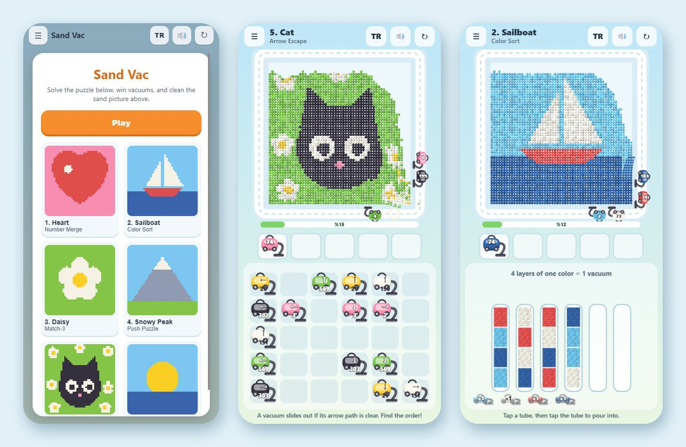
</p>

Prototype · HTML5 canvas · Android APK via Capacitor · No runtime dependencies · Turkish and English

---

## English

### How to play

1. **The picture** at the top is made of thousands of sand grains, and they really fall. Remove sand from below and the grains above slide down.
2. **Solve the puzzle** at the bottom to earn vacuum cleaners. A vacuum's colour is the sand colour it collects, and its number is how many grains it can hold.
3. Each new vacuum **rides the rail** once around the picture and sucks up every grain of its colour it can see. Its see-through bin fills up as it goes.
4. A vacuum that finishes its lap without filling up waits in the **5-slot dock**. Tap it to send it around again. If the dock is full when another vacuum comes back, you lose.
5. The level is complete when the picture is **spotless**.

### Levels

Every level pairs a sand picture with a different bottom puzzle.

<table>
  <tr>
    <td align="center" width="33%">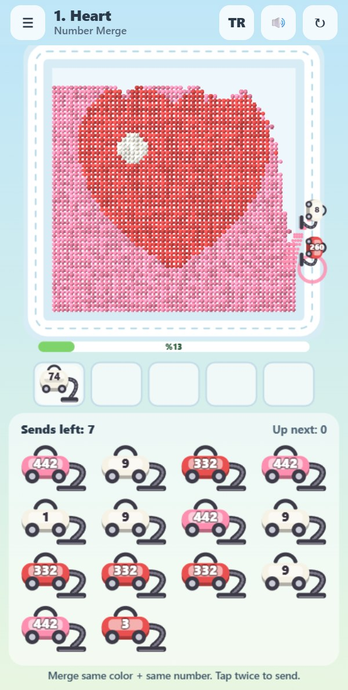<br><b>1. Heart · Number Merge</b><br>Merge two vacuums of the same colour and number. Every send uses up one move.</td>
    <td align="center" width="33%">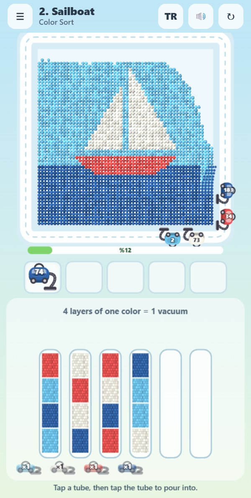<br><b>2. Sailboat · Color Sort</b><br>Pour sand between tubes. 4 layers of one colour turn into a vacuum.</td>
    <td align="center" width="33%">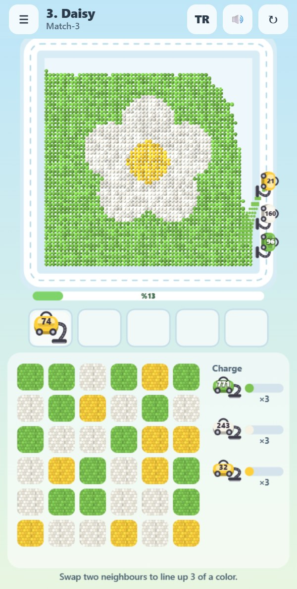<br><b>3. Daisy · Match-3</b><br>Matches fill that colour's charge bar. A full bar releases a vacuum.</td>
  </tr>
  <tr>
    <td align="center">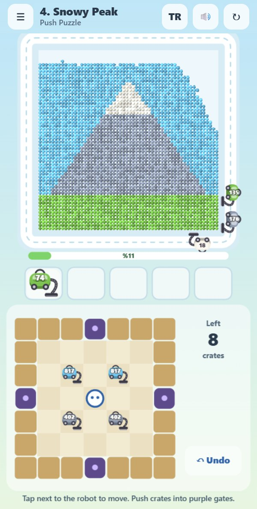<br><b>4. Snowy Peak · Push Puzzle</b><br>Push vacuum crates out through the purple gates. Undo is available.</td>
    <td align="center">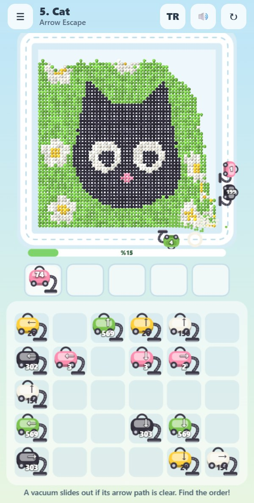<br><b>5. Cat · Arrow Escape</b><br>A vacuum slides out only if the path in its arrow's direction is clear.</td>
    <td align="center">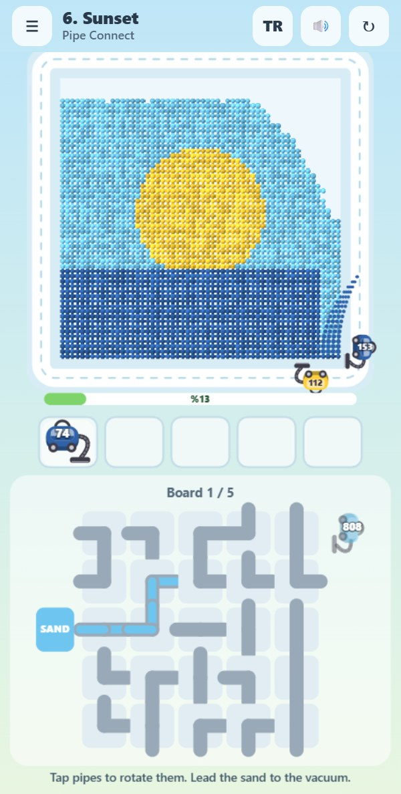<br><b>6. Sunset · Pipe Connect</b><br>Rotate pipes to lead the sand to the empty vacuum.</td>
  </tr>
</table>

### Language

The game is in Turkish and English. Use the **EN / TR** button in the top bar to switch, even in the middle of a level. The first language follows your device's language.

### Install

Download `SandVac-*.apk` from [Releases](../../releases) and open it on an Android phone (Android 6+). Android will ask you once to allow installs from unknown sources.

### Run locally

```bash
npm test                                   # 20 logic tests (node --test)
python -m http.server 8130 --directory www  # then open http://localhost:8130
```

Add `?debug` to the URL to expose the running game as `window.sandVacDebug` (used for automated checks and the screenshots in this README).

### Build the APK

Requires JDK 21 and the Android SDK.

```bash
npm install
npx cap copy android
cd android && ./gradlew assembleDebug      # app/build/outputs/apk/debug/app-debug.apk
```

> On Windows, if Gradle fails with `Unable to establish loopback connection`, your temp path contains a space. Point `TMP`, `TEMP` and `JAVA_TOOL_OPTIONS=-Djdk.net.unixdomain.tmpdir=<dir>` at a folder without spaces.

### Project layout

```
www/js/core/      sand simulation, pictures, palette, seeded RNG
www/js/puzzles/   the six bottom puzzles (pure logic + drawing)
www/js/game.js    rail, vacuums, dock, win / lose
www/js/i18n.js    Turkish and English strings
tests/            node:test suites, including a bot that clears every level
docs/screenshots/ README images (Turkish and English)
android/          Capacitor Android project
```

---

## Türkçe

<p align="center">
  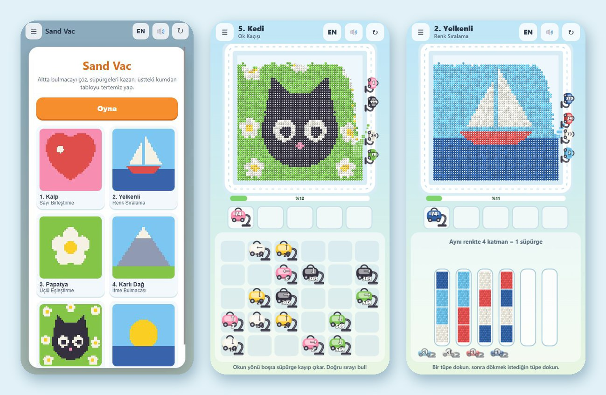
</p>

### Nasıl oynanır

1. Üstteki **resim** binlerce kum tanesinden oluşur ve taneler gerçekten akar. Alttan kum alınca üstteki taneler aşağı kayar.
2. Alttaki **bulmacayı çöz** ve elektrik süpürgeleri kazan. Süpürgenin rengi topladığı kumun rengidir, üstündeki sayı da kaç tane alabileceğidir.
3. Her yeni süpürge resmin etrafındaki **rayda** bir tur atar ve gördüğü kendi rengindeki tüm taneleri emer. Şeffaf haznesi yol boyunca dolar.
4. Turunu dolmadan bitiren süpürge **5 yerlik iskelede** bekler. Ona dokununca yeniden tura çıkar. Başka bir süpürge döndüğünde iskele doluysa kaybedersin.
5. Resim **tertemiz** olunca bölüm biter.

### Bölümler

Her bölümde bir kum resmi ve altta farklı bir bulmaca var.

<table>
  <tr>
    <td align="center" width="33%">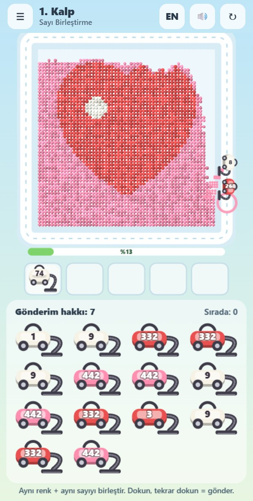<br><b>1. Kalp · Sayı Birleştirme</b><br>Aynı renk ve aynı sayıdaki iki süpürgeyi birleştir. Her gönderim bir hak harcar.</td>
    <td align="center" width="33%">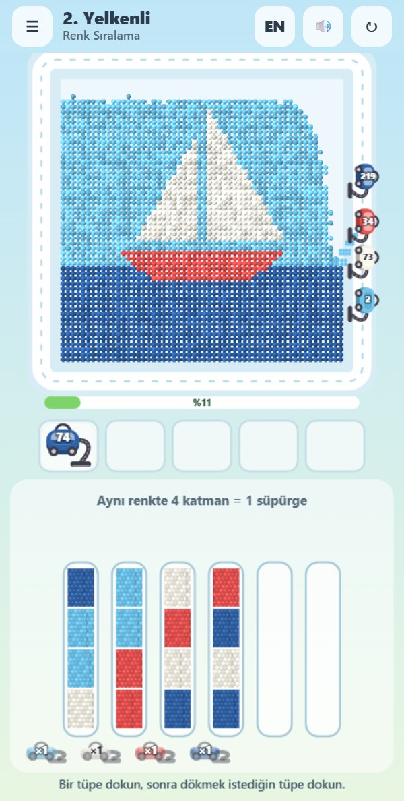<br><b>2. Yelkenli · Renk Sıralama</b><br>Kumu tüpten tüpe dök. 4 katmanı aynı renk olan tüp süpürgeye dönüşür.</td>
    <td align="center" width="33%">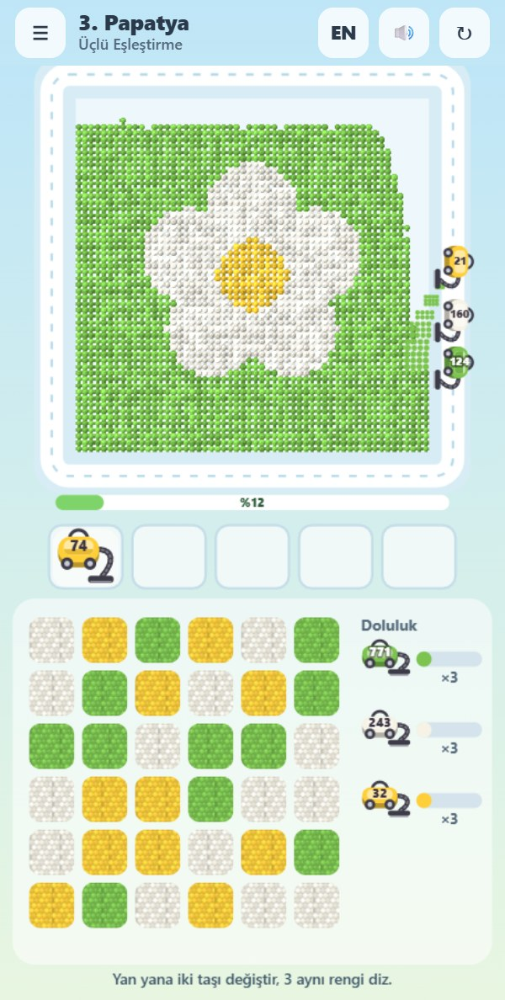<br><b>3. Papatya · Üçlü Eşleştirme</b><br>Eşleştirmeler o rengin göstergesini doldurur. Dolan gösterge bir süpürge çıkarır.</td>
  </tr>
  <tr>
    <td align="center">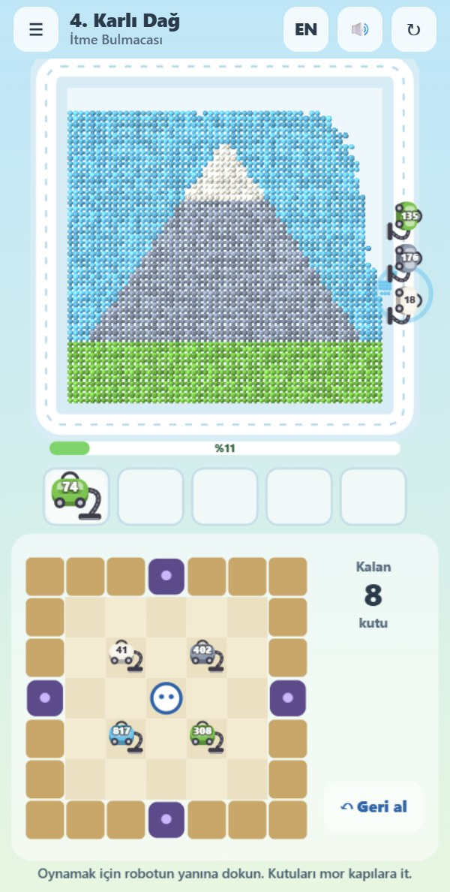<br><b>4. Karlı Dağ · İtme Bulmacası</b><br>Süpürge kutularını mor kapılardan dışarı it. Geri alma tuşu var.</td>
    <td align="center">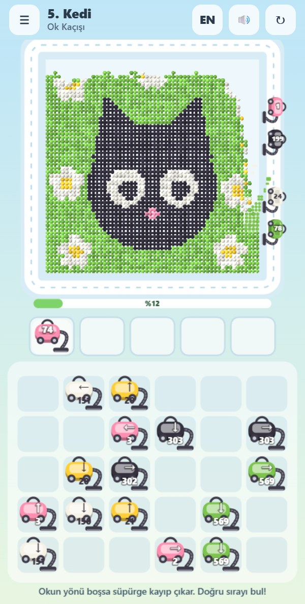<br><b>5. Kedi · Ok Kaçışı</b><br>Süpürge, okunun gösterdiği yol boşsa kayıp çıkar.</td>
    <td align="center">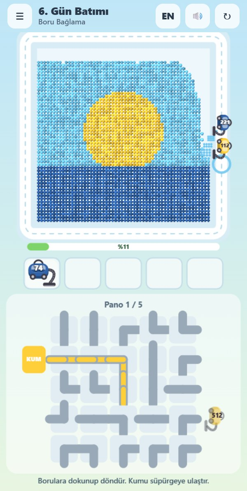<br><b>6. Gün Batımı · Boru Bağlama</b><br>Boruları döndürerek kumu boş süpürgeye ulaştır.</td>
  </tr>
</table>

### Dil

Oyun Türkçe ve İngilizce. Dili üst çubuktaki **EN / TR** düğmesiyle, bölümün ortasında bile değiştirebilirsin. İlk açılışta cihazının dili seçilir.

### Kurulum

[Releases](../../releases) sayfasından `SandVac-*.apk` dosyasını indirip Android telefonunda aç (Android 6 ve üzeri). Android bir kez bilinmeyen kaynaklardan yükleme izni ister.

### Yerelde çalıştırma ve APK derleme

Komutlar İngilizce bölümdekilerle aynı: testler için `npm test`, tarayıcıda oynamak için `www` klasörünü yerel bir sunucuyla aç. APK için `npx cap copy android`, ardından `android` klasöründe `gradlew assembleDebug` çalıştır. JDK 21 ve Android SDK gerekir.

---

Prototype built with [Claude Code](https://claude.com/claude-code).
